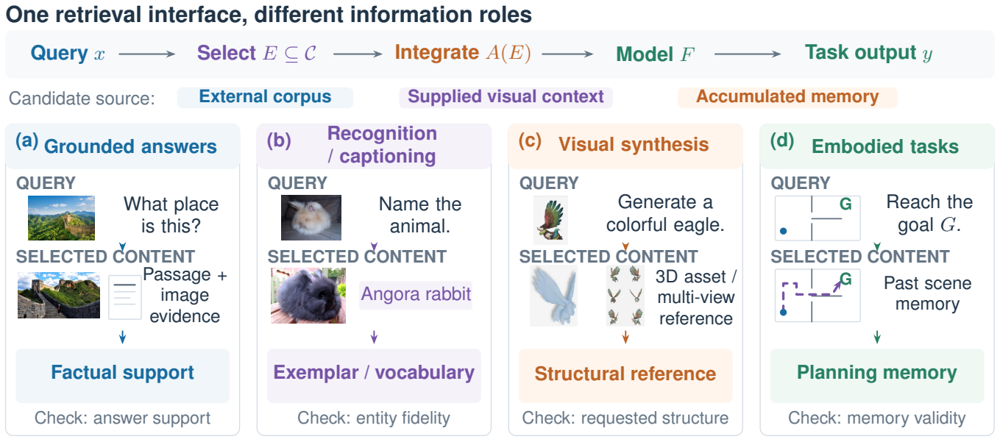
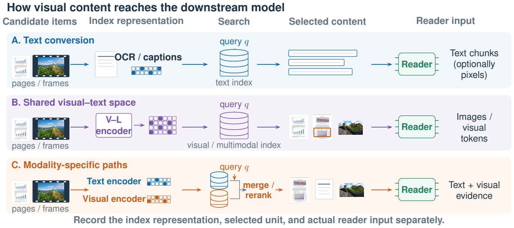
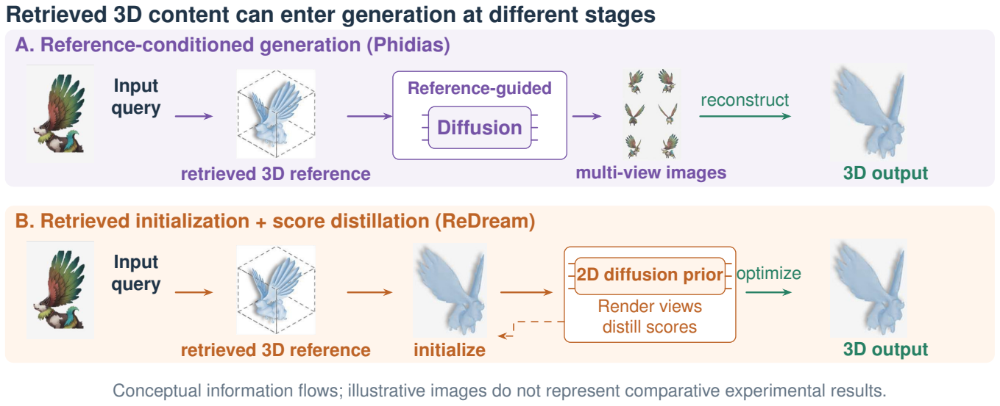

# Figures for the ACL survey revision

Updated 15 October 2026. These figures combine editable vector schematics with image elements from the earlier survey. They illustrate the conceptual framework; they are not new experimental predictions or replicated comparative outputs. The original 81-paper [DBLP verification](VERIFIED_REFERENCES.md) remains unchanged.

## Information roles across vision tasks

[Vector PDF](assets/acl-figures/overview.pdf). Concrete image, recognition, synthesis and memory examples distinguish the roles of selected information.

## Representations, retrieval and reader input

[Vector PDF](assets/acl-figures/representations.pdf). Aligned stages distinguish text conversion, shared visual–text representations and modality-specific indexes.

## Uses of retrieved 3D content

[Vector PDF](assets/acl-figures/structural_references.pdf). Schematic information flow for Phidias and ReDream; illustrative image elements are not comparative outputs.

## Design references and source elements

The stage structure and concrete query examples were informed by [Ask in Any Modality](https://aclanthology.org/2025.findings-acl.861/); the matched-panel comparison by [Scaling Beyond Context](https://aclanthology.org/2026.acl-long.204/); and representation/reader separation by [A Survey on Multimodal RAG](https://arxiv.org/abs/2504.08748). Their artwork was not copied.

The [element provenance](assets/acl-figures/source-elements.json) identifies original survey PDFs, extracted image objects, crops and dimensions. Text, arrows and schematics are vector content; original photos and renders remain raster images. Editable TikZ and the deduplicated image source are maintained alongside the manuscript in Overleaf.
